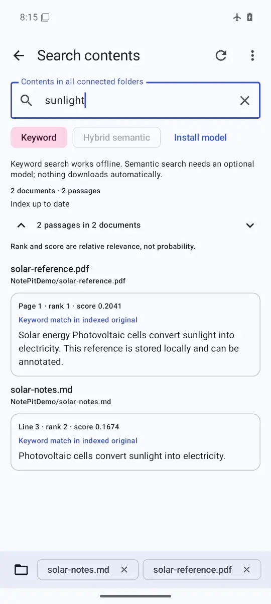

# NotePit

Offline-first Android document manager, PDF reader and code editor with local full-text and optional on-device semantic search. Native Kotlin/Jetpack Compose UI and SAF storage; PDF.js and CodeMirror run in restricted local WebViews. No account or cloud search.

[](https://giacomo-manfucci.pages.dev/pitverse/)
[](https://github.com/ManfuG/NotePit/releases/latest)

## Try and download

**[Download NotePit for Android — app-release.apk](https://github.com/ManfuG/NotePit/releases/latest/download/app-release.apk)**

[Project page](https://giacomo-manfucci.pages.dev/projects/notepit/) · [Latest release and checksums](https://github.com/ManfuG/NotePit/releases/latest)

Current release: **[0.4.3](https://github.com/ManfuG/NotePit/releases/tag/v0.4.3)** (Android version code 7), indexing new or changed files without rereading unchanged contents on reopening. Android-only: the project page is not a browser document editor. Requires Android **8.0/API 26+** and an updated Android System WebView.

## Demo

[](https://github.com/ManfuG/NotePit/raw/refs/heads/main/docs/demo.mp4)

**[Watch or download the Android demo (MP4, 54 seconds, no audio)](https://github.com/ManfuG/NotePit/raw/refs/heads/main/docs/demo.mp4)**

Recorded from the signed 0.4.1 app on an Android emulator: opening, granted-folder browsing, Markdown/math preview, editing and saving an original note, PDF reading, and keyword search across the note and PDF. Uses demonstration documents in a separate Android user; no personal files or model download.

The native launcher and Android splash share a cobalt/raspberry orbital notebook mark. A portfolio-derived orbital/botanical opening follows, branded **NotePit** in its own palette. Swipe up or activate the arrow to enter; it does not repeat on rotation or ordinary background/resume. The illustration is static, fully local and script-free, with no artificial delay.

## Install on Android

1. Download **[app-release.apk](https://github.com/ManfuG/NotePit/releases/latest/download/app-release.apk)** above.
2. Allow installation from the browser/file manager when Android asks, then install. Keep Android System WebView updated.
3. Open **Connect folder**, select a subfolder such as `Documents/Notes`, and grant access. Repeat for additional folders. Android restricts storage roots, Download root and `Android/data`.
4. Open documents, edit and explicitly **Save** to their original locations. Closing an edited document offers saving, retaining a draft or discarding changes.

The signed release uses a persistent private signing key for subsequent updates. **The earlier GitHub debug prototype used a different key**: Android may require uninstalling that prototype once. Save/export all unsaved work first; uninstalling removes app-private drafts, preferences and SAF grants, not your original shared-storage documents. Reconnect folders afterward. Do not uninstall a release build merely to upgrade it.

## Implemented

### Files

- Persistent read/write SAF access to multiple folders, progressive initial loading, stable same-folder refreshes and bounded directory caching.
- Filename search in the current folder, subfolders or all roots; name/date/size sorting, direction and type/conflict filters.
- Favorites, recent documents, long-press multiselect, contextual menus and bottom actions.
- Create, rename, copy, move and delete files/folders. Recursive transfers verify bytes and membership before removing a source; collisions and partial failures are reported, not silently overwritten.
- Syncthing internal/temporary files are excluded from browsing/search; conflict copies remain visible.

### Global search

- **Text search (0.3):** search document contents across granted folders, not just filenames. A private SQLite FTS4 index ranks passages with BM25 and retains text line ranges or PDF page references.
- **Hybrid semantic search (0.4):** optionally combine text ranking with local dense-vector similarity using reciprocal-rank fusion. Scores express relative relevance, not calibrated probabilities. Semantic results can be approximate, not literal query matches.
- Results include source paths and snippets. Opening a result reveals its text range or PDF page; literal occurrences are highlighted, while approximate semantic passages are labeled. Next/previous controls move between revealed matches.
- First connection indexes every supported file in the folder. Later foreground/provider refreshes reconcile directory metadata and read only new or changed files; existing text and embeddings are retained. **Refresh** explicitly verifies/rebuilds all files. Unreadable or incomplete extraction is reported.
- Indexing is bounded: up to **16 MiB per text file**, **64 MiB and 2,000 pages per PDF**, and **25,000 passages per document**. Oversized, encrypted, extraction-restricted or image-only PDFs are reported as exclusions; there is no OCR. Queries are limited to **256 characters** and results to **100 hits**.
- PDF indexing requires an extractable text layer. Search does not grant extra filesystem access, change originals, or replace explicit document saves. Automatic checks compare size, modification time, format and persistent document-change markers. NotePit saves and document-specific provider notifications invalidate only that document. External edits that preserve metadata and produce no usable notification require explicit **Refresh**.

#### Optional semantic model

Text search needs no model download. Semantic search requires an **explicit, one-time HTTPS download** from `huggingface.co`; no document content or query is sent to that service. Pinned model assets are SHA-256 verified before installation. The download is approximately **17.7 MB**, and installation requires at least **64 MiB** of available app storage.

After installation, embedding, vector indexing and hybrid search run **fully offline on the device** using ONNX Runtime. The model can be removed from the search settings without removing original documents. Derived passages and vectors stay in app-private storage; neither the index nor the model is written into connected folders. Removing the app removes its private data but not shared-storage originals.

The English-trained model is **sentence-transformers/paraphrase-MiniLM-L3-v2** (Apache-2.0), with a quantized ONNX conversion by **Xenova**, pinned to revision `4b544e74dfc3256b2b56849ea5d7064fee1ac846`. Semantic retrieval can miss relevant passages or return irrelevant ones; multilingual quality is not guaranteed. See the [source model card](https://huggingface.co/sentence-transformers/paraphrase-MiniLM-L3-v2) and [conversion](https://huggingface.co/Xenova/paraphrase-MiniLM-L3-v2). Runtime and model attribution is bundled in `public/THIRD_PARTY_NOTICES.txt`.

### PDFs

- Continuous scrolling, pinch zoom, width fit, page jumps, text search, selection/copy and embedded outlines when the PDF contains one.
- Highlights, text/drawing annotations and explicit saves to the original PDF, subject to document permissions.
- Reversible, content-detected margin cropping of visible pages; no PDF content is modified by cropping.
- Persistent page/position, zoom, rotation, crop setting and page bookmarks; multiple document tabs and immersive reading.
- Range-backed private snapshots, on-demand page rendering, bounded crop metadata and at most two live document renderers.

### Text/code

TXT, Markdown, LaTeX, Python, R, C/C++, JS/TS, HTML/CSS, JSON, YAML and Bash; syntax highlighting, line numbers, inferred indentation, search/replace, undo/redo and a language-specific toolbar above the keyboard.

Markdown previews render mathematical expressions with bundled KaTeX. LaTeX previews render formulas, **not a compiled LaTeX document**. Scripts, external resources and document-driven navigation are disabled in previews. KaTeX supports a mathematical subset of TeX, not arbitrary packages/macros.

UTF-8, UTF-8 BOM and BOM-marked UTF-16LE/BE retain their encoding. Existing mixed LF/CRLF/CR separators and indentation survive edits/undo. Unsupported encodings/binary data are rejected rather than silently converted.

## Synchronize computer ↔ phone

Syncthing performs synchronization independently. NotePit neither downloads/imports a directory tree nor runs a second sync engine.

1. **Computer:** install [official Syncthing](https://syncthing.net/downloads/) for Linux or Windows. Start it and open its local Web GUI, normally `http://127.0.0.1:8384`. On Linux, a distribution-provided user service can be enabled with `systemctl --user enable --now syncthing.service`; on Windows, run the downloaded executable and keep it running.
2. **Phone:** install the maintained [researchxxl Syncthing-Fork](https://github.com/researchxxl/syncthing-android/releases), package `com.github.catfriend1.syncthingfork`. Complete its onboarding and storage permission setup. Other Play forks and the discontinued official wrapper are not assumed equivalent.
3. **Pair:** initially put both devices on the same network. Add the other device's Device ID on each side and accept pairing. Share the computer notes folder with the phone; accept it in the Fork, using an ordinary phone directory such as `Documents/Notes`. Use the same **Folder ID** and **Send & Receive** on both devices.
4. **Protect:** configure receiving-side file versioning in Syncthing and keep independent backups. In Android's app information/battery controls, allow the Fork's background operation if desired; wording and availability vary by device. Review the Fork's run conditions. Background exemptions can increase battery consumption.
5. **NotePit:** open **Folder actions → Sync**, follow the four-step guide and select the exact same phone directory through SAF. Associate each granted directory with its Syncthing Folder ID after checking both apps. This is your confirmation, not automatic path verification.
6. **Check:** create a disposable text file on the computer and verify it reaches the phone. Edit/save it in NotePit and verify the computer receives it. Then test an offline edit and reconnection before relying on the setup.

Both peers, their sync engines and a usable network path must be available for transfer. Offline NotePit editing does not depend on the companion or API being reachable. Concurrent edits can generate `.sync-conflict-…` copies; preserve both until you choose the correct contents. Syncthing is synchronization, not a substitute for backups.

### Optional local status monitoring

The sync screen can read authenticated snapshots from the Fork's REST API. It never assumes installation means the service is running.

- In the Fork, use **Settings → Syncthing Options → API key** to copy the key; confirm the GUI port. Use the same Android profile for both apps.
- In NotePit, expand **Set up / replace API connection**, enter `https://127.0.0.1:8384` (or the configured port) and paste the key.
- The first HTTPS connection displays its SHA-256 certificate fingerprint for explicit trust. Compare it with the intended local service when possible. This is trust-on-first-use, not independently authenticated discovery. Later connections pin the exact certificate; a changed certificate requires reconnection and explicit trust.
- The administrative API key is encrypted with AndroidKeyStore and never exposed to the document WebViews. NotePit only reads status/configuration. HTTP is an explicit loopback-only opt-in with a warning; prefer HTTPS.
- Reconfirm folder links against the authenticated local Device ID. Generic SAF URIs cannot reliably be translated into Syncthing filesystem paths.
- **Refresh folders and status** obtains a timestamped snapshot. Errors/unavailable service are explicit. Local index current and peer connected are **not proof of remote receipt** or global convergence. There is no background polling.

Only the companion's public launcher is used. No undocumented pairing/configuration intents, private API-key access or automatic device/folder provisioning are assumed. [REST API reference](https://docs.syncthing.net/dev/rest).

## Integrity and lifecycle

- File operations, hashing, transfer verification and network requests run off the UI thread. Stale listings/searches are cancellable.
- An immutable private snapshot and SHA-256 revision protect an open file. External metadata changes are reported; saves recheck content and refuse stale overwrites. **Reload original** and **Save a separate copy** let you resolve the situation explicitly.
- Saves retain a persistent original backup and verify the written bytes; failed writes trigger best-effort verified restoration. Failed recovery reports the retained original's private path.
- Text changes are journaled incrementally to private storage; PDF annotation changes produce debounced private drafts without blocking typing. Reading state and open-document identities are durable. Original files change only on explicit save.
- SAF has no transactional compare-and-swap against another writer. An external writer can still race a check; provider/device failures and sudden power loss are not atomic-save guarantees. Avoid editing the same document simultaneously.
- Draft recovery protects completed journal/draft writes, not an uncommitted keystroke killed before it reaches persistent storage. Keep backups and save important work. Renderer memory/file capacity still depends on the device.

## Build and tests

Requires Node **22.23.4+ (22.x), 24.22.1+ (24.x), or 26.12.1+ (26.x)**, **JDK 21** and Android SDK 36. Set `JAVA_HOME` and `ANDROID_HOME`, or keep the SDK location in ignored `android/local.properties`.

```sh
npm ci
npm test
npm run android:build
npm run android:test
# With an Android emulator/device connected:
cd android
./gradlew connectedDebugAndroidTest
```

Debug APK: `android/app/build/outputs/apk/debug/app-debug.apk`.

```sh
npm run android:release
```

Signed APK: `android/app/build/outputs/apk/release/app-release.apk`. The first explicit local release creates private `.signing/keystore.jks` and `config.json`; back up that directory securely. Losing the key prevents compatible future updates. CI uses repository secrets `ANDROID_KEYSTORE_BASE64` and `ANDROID_KEYSTORE_PASSWORD`; keys/passwords are never committed.

Builds provision the pinned official PDF.js 6.4.299 legacy distribution with its published SHA-256, local worker/fonts/CMaps/WASM, and offline math assets. A guarded FreeText snapshot patch keeps Android's keyboard/caret intact during drafts; builds reject an unexpected upstream implementation. Third-party notices are generated from locked runtime dependencies. GitHub Actions builds APKs, runs editor tests and invokes the JVM test task; device instrumentation was run locally, not claimed as CI emulator coverage.

### Verification scope

The repository includes editor invariants and Android resolver/provider, transfer, save-recovery and loopback synchronization tests. The commands above are the reproducible entry points; a successful build alone does not establish document correctness, physical-device performance or sync convergence.

For release verification, use real SAF grants and original-file saves, reopen indexed text/PDF search results, exercise next/previous highlights, and repeat semantic search with networking disabled after an explicitly approved model download. Also check interrupted indexing, unavailable folders, model removal and document editing/PDF annotations alongside search.

Device-specific battery policies, desktop-to-phone transfer and the installed Syncthing-Fork pairing must be checked on the intended setup. No physical-device benchmark or universal background-operation guarantee is claimed.

### Measured search checks

API 36 x86_64 emulator; synthetic fixtures, not physical-phone or general retrieval-quality guarantees. Keyword timings include native retrieval and provider validation, exclude the UI's 300 ms typing debounce, and use no embedding model.

| Check | Observed result |
| --- | --- |
| Keyword corpus | 100 documents, 1,091 passages, 292,300 source bytes |
| Keyword index | 1,736,704 bytes (1.66 MiB) |
| Initial indexing / one-edit refresh | 627.5 ms / 213.4 ms |
| Keyword query median / p95 | 33.9 ms / 37.3 ms |
| Literal source retrieval | 100/100 deterministic queries |
| Offline embedding cold / warm median | 247.6 ms / 27.0 ms |
| Semantic question retrieval | 4/4 non-identical questions chose the intended passage |
| Semantic-test process PSS before / after inference | 161.6 MiB / 215.8 MiB; increase 54.2 MiB |

The semantic check ran with Wi-Fi and mobile data disabled after explicit model installation. Its four questions are a smoke check, not an estimated real-world accuracy rate. Process PSS includes the Android test runtime and shared mappings; it is not a model-only allocation or a peak-memory measurement.

Verification includes 12 editor invariants, 10 tokenizer unit tests, 20 SAF/storage tests, 13 native index tests, 7 loopback sync tests and the opt-in real-model smoke. Index coverage includes zero unchanged-source reads across index/repository recreation, changed-file-only reads, saves with missing provider metadata, explicit verification of silent external edits, removal/disconnection, encoding and coordinates, exclusions, BM25 ordering, queries during a blocked refresh, and changing folder metadata without self-triggered reindexing.

To repeat the real-model smoke after installing the model through the app and disabling device networking:

```sh
adb shell am instrument -w -r \
  -e class io.notepit.app.SemanticEngineSmokeTest -e semanticSmoke true \
  io.notepit.app.test/androidx.test.runner.AndroidJUnitRunner
```

### Repository privacy

Current project examples and documentation use generic identities; third-party attribution is retained. The audit found no probable committed live credentials or private signing keys. Four pre-existing commits retain personal author/committer metadata and older documentation references. No published history was rewritten: removing that exposure requires a separately coordinated history cleanup, including existing clones and cached artifacts. Use privacy-safe author/committer settings for future commits.

### [0.4.3](https://github.com/ManfuG/NotePit/releases/tag/v0.4.3) — changed-file-only indexing

Initial indexing reads all supported files. Subsequent automatic scans use persisted metadata/change markers and do not open unchanged sources. Changed files are hashed before extraction, preserving passages/embeddings when the bytes are identical. Completed documents remain reusable after interrupted scans or reopening; no index reset or UI changes.

### [0.4.2](https://github.com/ManfuG/NotePit/releases/tag/v0.4.2) — stable folder refresh

Folder metadata reads no longer trigger another browse/index refresh. Provider observation avoids overlapping registrations, and the browser retains rows during same-folder refreshes without duplicate change subscriptions. Navigation still clears the previous folder. Content hashing and incremental extraction are unchanged.

### [0.4.1](https://github.com/ManfuG/NotePit/releases/tag/v0.4.1) — suite alignment and security

Adds the NotePit-branded opening described above, retaining existing documents, drafts and signing identity. Updated Node/CI security floors and the build-only fflate dependency. [PHP2Shell](https://github.com/NCSC-NL/php2shell) has no identified PHP runtime here; the [October Node advisories](https://nodejs.org/en/blog/vulnerability/october-2026-security-releases) apply to build/download tooling, not an Android Node server. Clean installation and npm audit report zero known findings. Twelve editor invariants and signed API 36 opening/dismissal/resume checks passed. Release binaries are locally built and verified; duplicate hosted CI is skipped.
